# vox-style-video

Vox-style **paper-collage motion graphics** built in code with [Remotion](https://www.remotion.dev): a measured style system, a primitive library, a photo-cut-out asset pipeline, and a Claude Code skill that runs the whole workflow.

用代码复刻 Vox 风格的纸张拼贴动态图形：逐帧测量出的风格系统、Remotion 组件库、照片抠图素材流程，以及一个 Claude Code skill。

> **Two layers.** `vox` (see [13-vox-editorial.md](style/collage-motion/13-vox-editorial.md)) is the Vox editorial grammar: 24 fps, evidence on screen with `#FFF200` highlights and source lines, maps, archival prints, a camera that never freezes. The 9 collage presets (measured from 8 non-Vox references) are optional art-direction registers on top.

### Vox collage (default "Vox style"): 立木为信 v3
Printed halftone cut-outs (real Qin artifacts + original woodblock-style illustrations, labelled) on one bold colour per shot, cut-out lettering with **one font per text element**, scraps, seal; pieces on 2s, camera smooth. Theme bake-off picks the palette before rendering. See [`14-vox-collage.md`](style/collage-motion/14-vox-collage.md).

| | | |
|---|---|---|
| 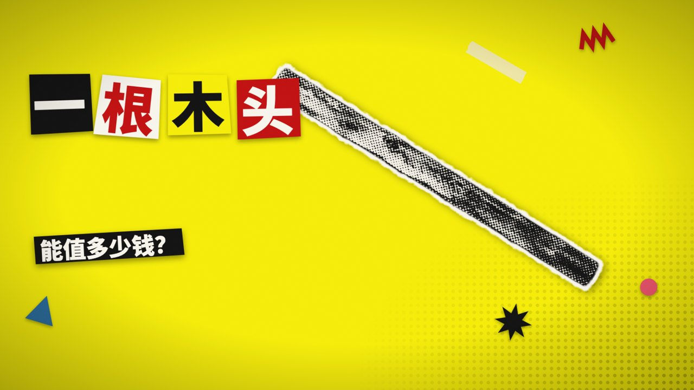 |  |  |

Theme bake-off (same shots, four themes): 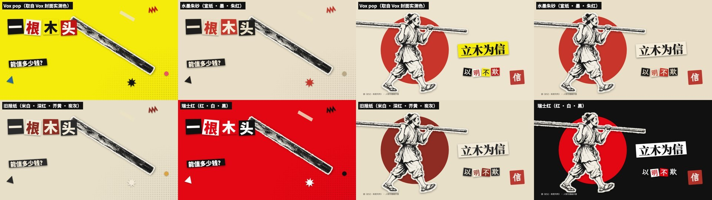

Video: [`docs/media/vox-qin-pole-collage-720p.mp4`](docs/media/vox-qin-pole-collage-720p.mp4)

### Vox editorial register, bold dark look: 立木为信 v2
Measured from 5 real Vox videos (local study only): dark stage, film grain, oversized cropped type, labels in boxes, red tags, hand-drawn annotations, dark relief map, a cut every 1.5–3 s.

| | |
|---|---|
| 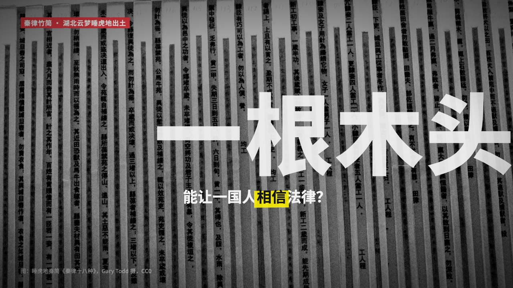 | 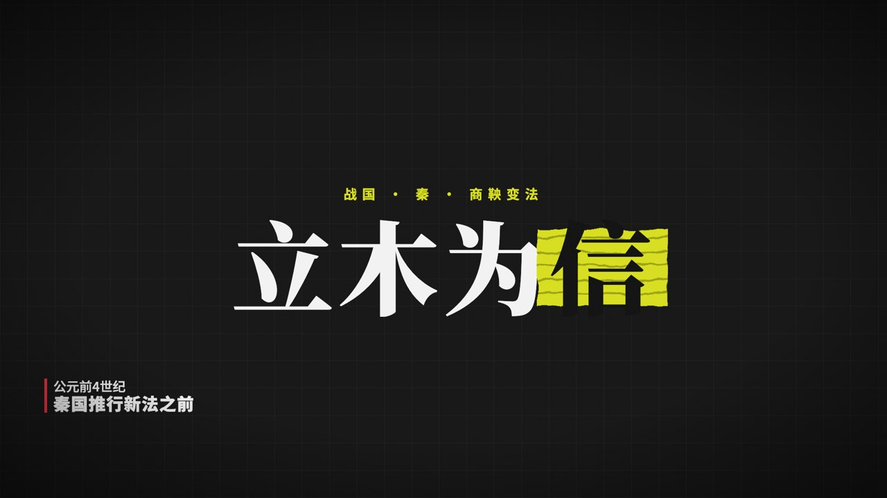 |
| 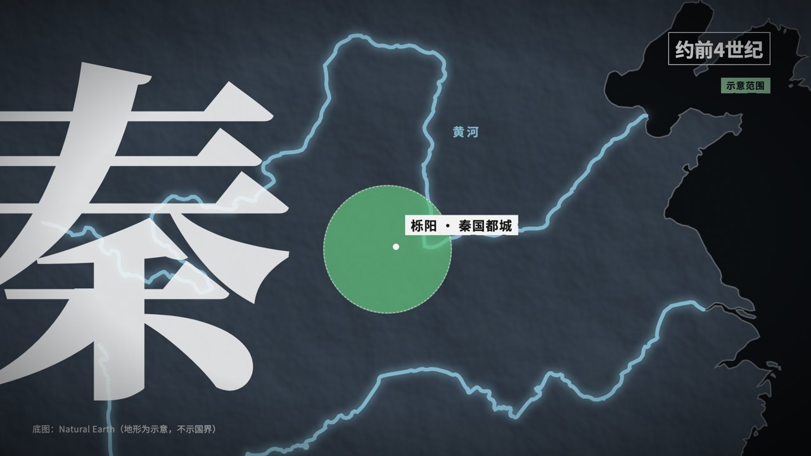 | 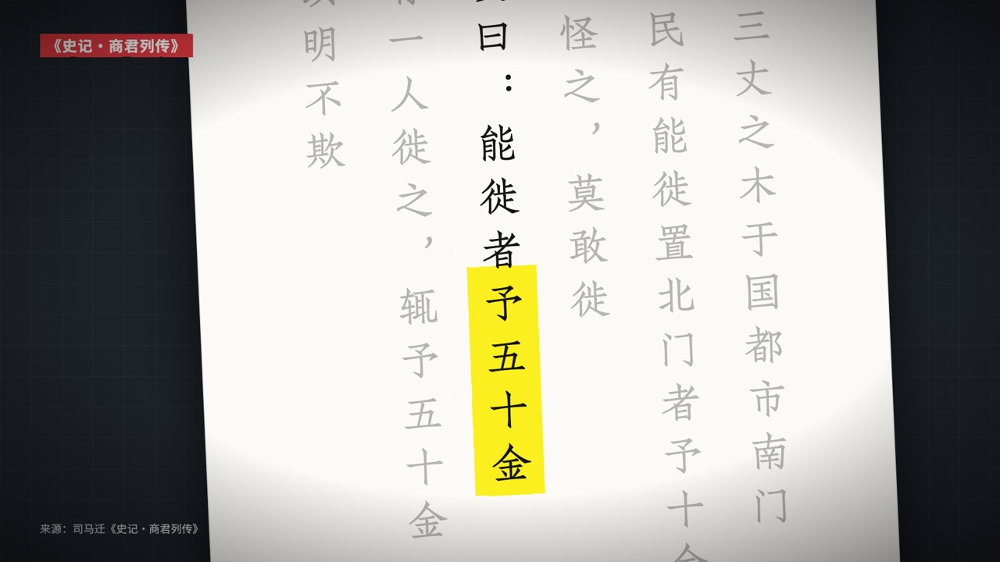 |
| 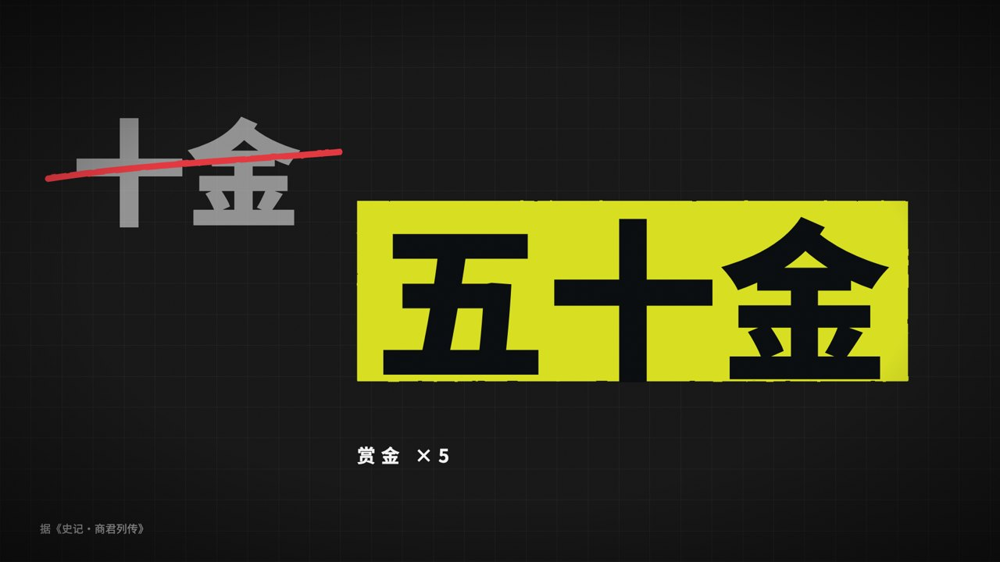 | 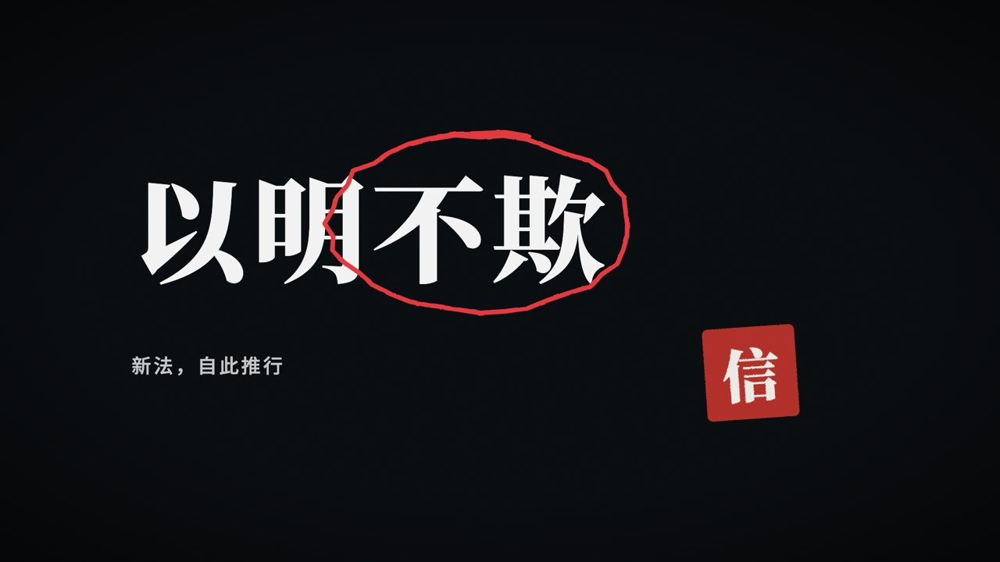 |

Video: [`docs/media/vox-qin-pole-bold-720p.mp4`](docs/media/vox-qin-pole-bold-720p.mp4)

### Vox preset, light variant (`vox-light`): 立木为信 v1
| Archival evidence + question | Map (land only, Natural Earth) |
|---|---|
| 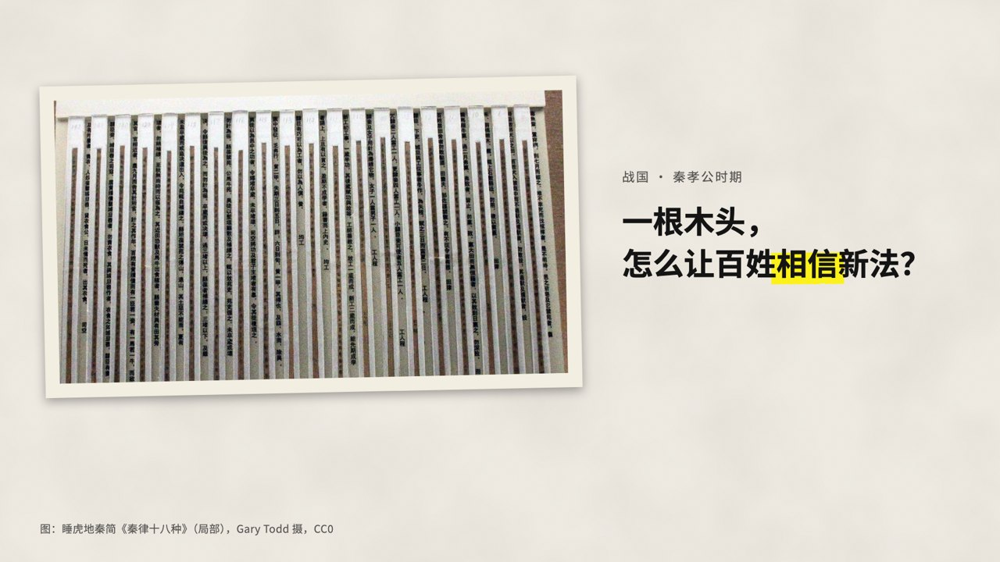 | 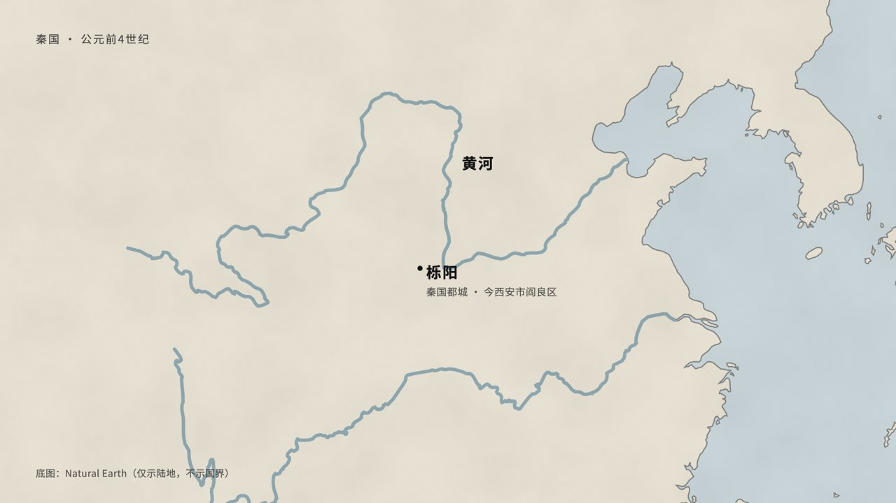 |
| **Source text, highlighted** | **Title card + seal** |
| 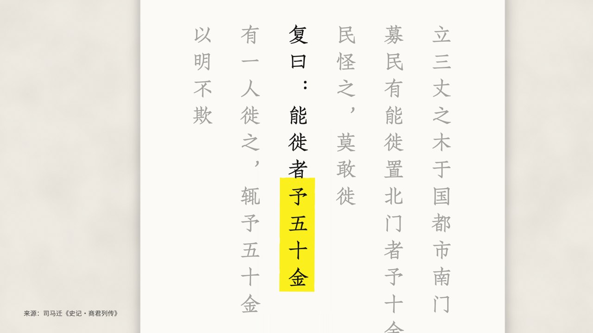 | 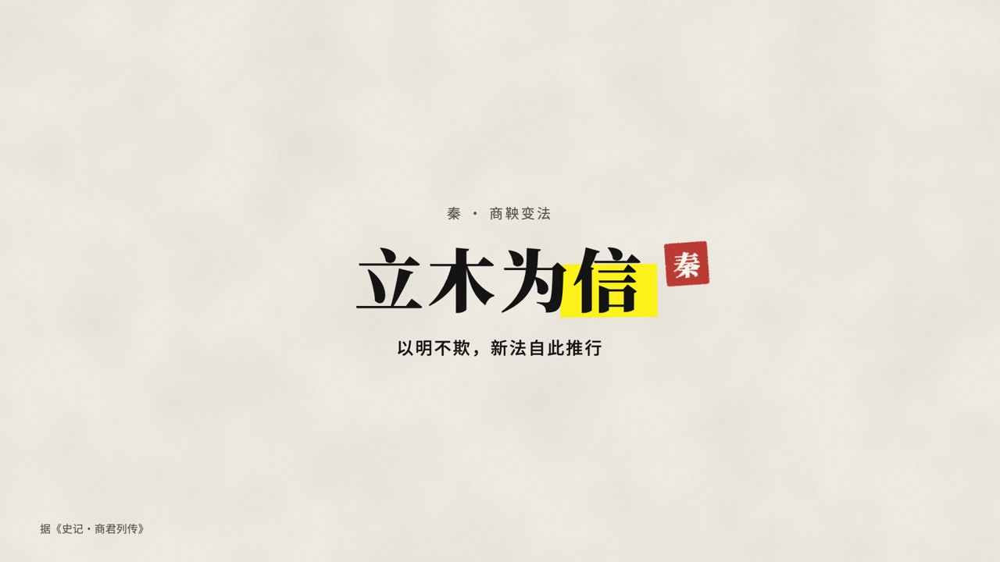 |

Video: [`docs/media/vox-qin-pole-720p.mp4`](docs/media/vox-qin-pole-720p.mp4) · credits: [`public/evidence/qin/CREDITS.md`](public/evidence/qin/CREDITS.md)

### Collage presets
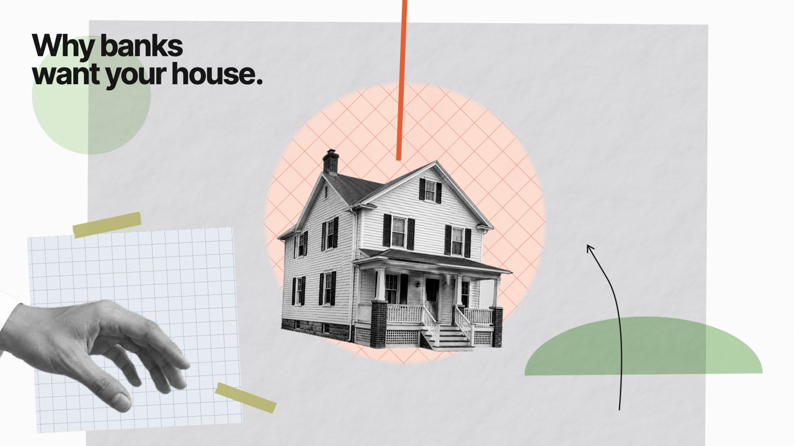

| Archive preset | Duotone burst preset |
|---|---|
| 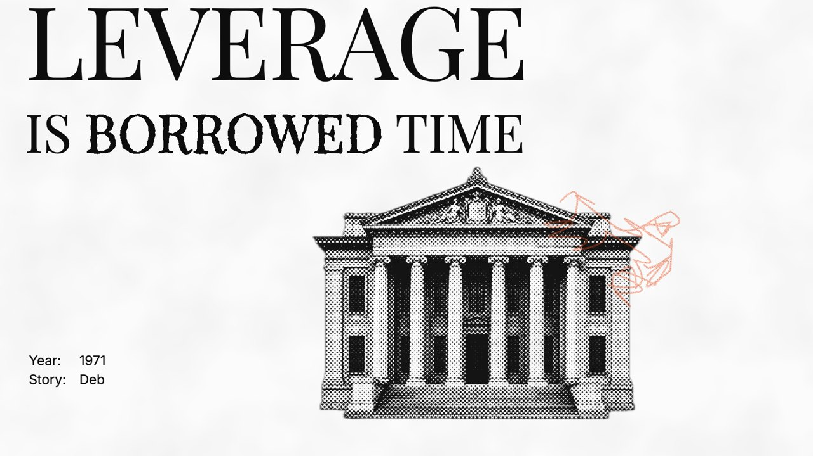 | 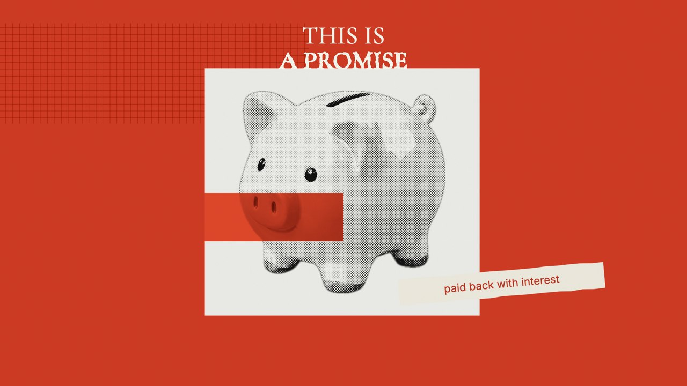 |

Demo video (12 s, 3 presets): [`docs/media/explainer-demo-720p.mp4`](docs/media/explainer-demo-720p.mp4) · Material QA sheet: [`docs/media/texture-sheet.jpg`](docs/media/texture-sheet.jpg)

## What's inside
| Path | What |
|---|---|
| [`style/collage-motion/`](style/collage-motion/README.md) | The instruction system: 12 principles, colour, typography, layout, textures, 30 motion primitives, 19 transitions, 9 presets, Remotion implementation, asset pipeline, explainer playbook, QA checklist |
| [`references/notes/`](references/notes) | Frame-by-frame analyses of 8 reference videos. Every number in the style system traces back here |
| [`src/collage/`](src/collage/index.ts) | Primitive library: stepped clocks, overshoot pop tables, crumpled/graph paper, newsprint halftone, duotones, sticker/halo/fringe edges, torn paper, pencil scribble, type-on, pose jumps, whip-pan, ink blackout, tile mosaic, disc iris… |
| [`src/demo/`](src/demo) | `ExplainerDemo` (1080p and 4K) and the `TextureSheet` still |
| [`src/stories/`](src/stories) | `VoxQinPoleBold` (default bold look) and `VoxQinPole`: the vox preset end to end (archival print, map fly-to, vertical classical text with highlight, title card, scored and mastered) |
| [`scripts/assets/`](scripts/assets) | `find_images.py` (licensed image search with a preview sheet), `cutout.swift` (on-device background removal with Apple Vision), `treat.py` (grade + matte cleanup + size check) |
| [`scripts/audio/`](scripts/audio) | **BGM vs SFX** pipeline: `find_audio.py` (Incompetech, ccMixter, FMA, Commons, Freesound), `compose_bgm.py` (original beds via FluidSynth), `tone_sfx.mjs` (SFX palette via Tone.js), `master.py` (−14 LUFS) |
| [`scripts/prep_reference.py`](scripts/prep_reference.py), [`scripts/cadence.py`](scripts/cadence.py) | Analyse any video: every frame, contact sheets, palettes, hold-length cadence. Run it on references **and on your own renders** |
| [`skill/`](skill/SKILL.md) | The `vox-style-video` Claude Code skill |

## Quick start
```bash
npm install
```
```bash
npm run studio
```
```bash
npx remotion render src/index.ts ExplainerDemo out/demo.mp4
```

Install the Claude Code skill (builds `~/.claude/skills/vox-style-video` from this repo):
```bash
bash scripts/install_skill.sh
```

## The style in one paragraph
Photographs are cut out cleanly, with no outline or shadow, and pasted onto real paper. Each frame has **one** saturated accent against greyscale or treated photos and flat pastel shapes. Everything moves on a **stepped clock** (12 drawings/s → holds of 3,2,3,2 frames at 30 fps): props pop in with overshoot, captions jump between held poses, and the paper re-rolls its texture while the photos stay pixel-still. Scenes change by hard cut, carried by a whip or push before the cut and an expo settle after it, or by physical paper (ink blackout, sliding sheet, tile mosaic). Nothing cross-dissolves.

## Assets: photographic, always
Heroes and props must be real photo cut-outs, never rough drawings. The pipeline ([`09-assets.md`](style/collage-motion/09-assets.md)):
1. **Search** licensed sources (Wikimedia Commons, Wikidata, Library of Congress, Art Institute of Chicago), pick from a preview sheet, and record credits automatically.
2. **Generate** generic objects with an image model on a plain grey backdrop when the search finds only cluttered or low-res images. The demo cut-outs in `public/cutouts/` were generated this way.
3. **Cut out** on device with Apple Vision (macOS 14+), then **grade** to the preset and size-check.

Real people are only ever shown through licensed photographs, never AI likenesses. No brand logos are reproduced.

## Sound: BGM and SFX are different jobs
**BGM** is one music bed for the whole video; **SFX** are short cues glued to specific motions (pop, slam, whip, stamp, paper slide). See [`12-audio.md`](style/collage-motion/12-audio.md).
- Library first: `find_audio.py --kind bgm|sfx` searches free, reusable sources, keeps CC0/BY/BY-SA, measures loudness and tempo, and writes credits.
- If nothing fits: `compose_bgm.py` writes an original bed (MIDI → FluidSynth, 4 styles, exact length, beat grid for cut sync), and `tone_sfx.mjs` synthesizes the 14-sound SFX palette.
- `master.py` masters the final mix to −14 LUFS. The demo's cuts land on the composed music's downbeats, and 28/28 SFX cues land within 2 frames of their motion.

## Notes
- This is a study of a visual *style*. It is not affiliated with Vox Media and does not include any of their logos, footage or music.
- The reference videos are third-party works and are **not** included. See [`references/README.md`](references/README.md) for links and how to rebuild the analysis locally.
- Requirements: Node 20+, Python 3 with Pillow + NumPy, ffmpeg, macOS 14+ for the Vision cut-out tool; for audio: `brew install fluid-synth aubio` and the [GeneralUser GS](https://github.com/mrbumpy409/GeneralUser-GS) soundfont in `~/.local/share/soundfonts/`.

## License
MIT for code, docs and the generated demo assets. See [LICENSE](LICENSE).
